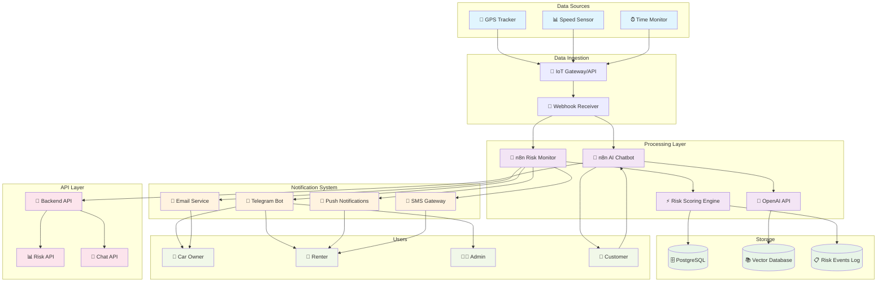
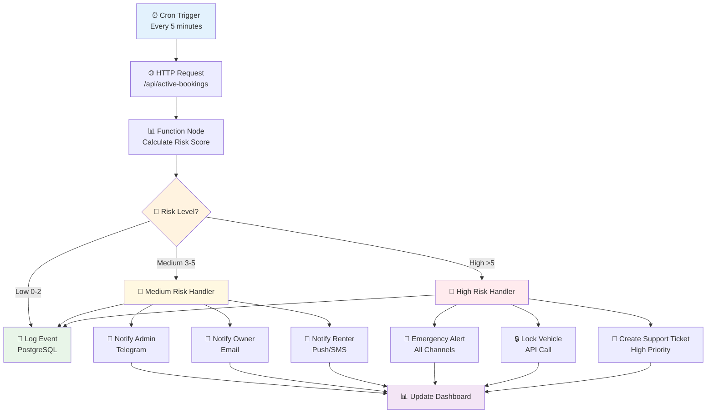

# 🚗 Car Rental DApp – Risk Monitoring & AI Chatbot (Technical Plan)

## 📌 Mục tiêu
Xây dựng hệ thống giám sát rủi ro theo thời gian thực cho các xe đang được thuê và chatbot hỗ trợ khách hàng nhằm:
- Bảo vệ quyền lợi **chủ xe** và **người thuê**.
- Phát hiện sớm hành vi bất thường (chạy quá xa, quá nhanh, trả xe trễ).
- Tự động thông báo cho admin/owner/renter.
- Tích hợp chatbot AI để giải đáp câu hỏi, hiển thị trạng thái booking, hỗ trợ quy trình ký hợp đồng và thanh toán đặt cọc.

---

## 🏗 Kiến trúc hệ thống



---

## 📊 Bộ Quy Tắc Đánh Giá Rủi Ro

### 1. **GPS Distance**
| Condition | Risk Level | Action |
|-----------|------------|--------|
| < 10 km | `Safe` | No alert |
| 10–100 km | `Warning 1` | Notify renter, log for admin |
| 100–300 km | `Warning 2` | Notify admin + owner |
| > 300 km | `Warning 3` | High risk alert, escalate process |

### 2. **Average Speed** (30 min window)
| Condition | Risk Level | Action |
|-----------|------------|--------|
| < 80 km/h | `Safe` | No alert |
| 80–120 km/h | `Warning 1` | Notify renter about safe driving |
| > 120 km/h | `Warning 2` | Notify admin + owner |

### 3. **Contract Status**
| Condition | Risk Level | Action |
|-----------|------------|--------|
| > 60 min left | `Safe` | No alert |
| 0–60 min left | `Reminder` | Notify renter to prepare return |
| Overdue < 30 min | `Minor Delay` | Notify admin + owner, warn renter |
| Overdue > 30 min | `Major Delay` | Trigger retrieval process |

### **Risk Score Calculation**
**Risk Score = Tổng điểm**
- `Warning 1` → **+1**
- `Warning 2` → **+3** 
- `Warning 3` → **+5**
- `Minor Delay` → **+2**
- `Major Delay` → **+4**

**Phân loại cuối cùng:**
- **0–2**: `Low` → log
- **3–5**: `Medium` → alert admin/owner
- **> 5**: `High` → escalate, lock vehicle (nếu policy cho phép)

---

## 🧩 Quy trình n8n – Risk Monitor Workflow



---

## 💬 Quy trình n8n – AI Chatbot Workflow

```mermaid
flowchart TD
    A[📨 Webhook<br/>User Message] --> B[🧠 OpenAI<br/>Intent Classification]
    
    B --> C{🎯 Intent Type}
    
    C -->|FAQ| D[📚 RAG Search<br/>Vector Database]
    C -->|Booking Status| E[🔗 Backend API<br/>/api/booking/{id}]
    C -->|Risk Check| F[📊 Risk API<br/>/api/booking/{id}/risk]
    C -->|Sign Contract| G[🔐 MetaMask<br/>Deep Link Generator]
    C -->|Report Issue| H[🎫 Support Ticket<br/>Creation]
    C -->|Unknown| I[❓ Fallback<br/>Human Handoff]
    
    D --> J[🤖 OpenAI<br/>Generate Response]
    E --> K[📋 Format Booking<br/>Information]
    F --> L[⚠️ Format Risk<br/>Report]
    G --> M[🔗 Generate Contract<br/>Signing Link]
    H --> N[✅ Create Ticket<br/>& Confirmation]
    I --> O[👨‍💼 Forward to<br/>Human Agent]
    
    J --> P[💬 Send Response<br/>to User]
    K --> P
    L --> P
    M --> P
    N --> P
    O --> P
    
    P --> Q[📝 Log Conversation<br/>Analytics]
    
    style A fill:#e3f2fd
    style B fill:#f3e5f5
    style C fill:#fff3e0
    style P fill:#e8f5e8
    style Q fill:#fce4ec
```

---

## 🗄 Database Schema (PostgreSQL)

### **Bookings Table**
```sql
CREATE TABLE bookings (
    id SERIAL PRIMARY KEY,
    vehicle_id INTEGER NOT NULL,
    renter_id INTEGER NOT NULL,
    owner_id INTEGER NOT NULL,
    start_time TIMESTAMP NOT NULL,
    end_time TIMESTAMP NOT NULL,
    status VARCHAR(50) DEFAULT 'active',
    deposit_amount DECIMAL(10,2),
    created_at TIMESTAMP DEFAULT NOW()
);
```

### **Telemetry Table**
```sql
CREATE TABLE telemetry (
    id SERIAL PRIMARY KEY,
    vehicle_id INTEGER NOT NULL,
    booking_id INTEGER,
    latitude DECIMAL(10, 8) NOT NULL,
    longitude DECIMAL(11, 8) NOT NULL,
    speed_kmh DECIMAL(5, 2) NOT NULL,
    timestamp TIMESTAMP DEFAULT NOW(),
    FOREIGN KEY (booking_id) REFERENCES bookings(id)
);
```

### **Risk Events Table**
```sql
CREATE TABLE risk_events (
    id SERIAL PRIMARY KEY,
    booking_id INTEGER NOT NULL,
    vehicle_id INTEGER NOT NULL,
    risk_type VARCHAR(50) NOT NULL, -- 'distance', 'speed', 'time_overdue'
    risk_level VARCHAR(20) NOT NULL, -- 'low', 'medium', 'high'
    risk_score INTEGER NOT NULL,
    distance_km DECIMAL(8, 2),
    avg_speed_kmh DECIMAL(5, 2),
    time_overdue_minutes INTEGER,
    action_taken VARCHAR(100),
    created_at TIMESTAMP DEFAULT NOW(),
    FOREIGN KEY (booking_id) REFERENCES bookings(id)
);
```

### **Chat Logs Table**
```sql
CREATE TABLE chat_logs (
    id SERIAL PRIMARY KEY,
    user_id INTEGER,
    session_id VARCHAR(100),
    intent VARCHAR(50),
    user_message TEXT,
    bot_response TEXT,
    confidence_score DECIMAL(3, 2),
    created_at TIMESTAMP DEFAULT NOW()
);
```

---

## 📢 Thông Báo & Escalation

### **Medium Risk:**
- 🚨 Gửi cảnh báo nhẹ, yêu cầu renter xác nhận hành trình
- 📧 Thông báo email cho chủ xe
- 📱 Tin nhắn Telegram cho admin

### **High Risk:**
- 🔴 Cảnh báo admin, chủ xe ngay lập tức
- 🔒 Tùy chọn khóa xe qua API (nếu có thiết bị IoT)
- 🎫 Tạo ticket high-priority cho bộ phận chăm sóc khách hàng
- 📞 Gọi điện trực tiếp (nếu cần thiết)

---

## 🔧 Bước Triển Khai (Step-by-Step)

### **Phase 1: Infrastructure Setup**
1. **Docker Compose** cho PostgreSQL + n8n + Redis
2. **Environment Variables** configuration
3. **Database Migration** scripts

### **Phase 2: Backend APIs**
1. **Active Bookings API**: `/api/active-bookings`
2. **Risk Assessment API**: `/api/booking/{id}/risk`
3. **Telemetry Ingestion API**: `/api/telemetry`
4. **Chat API**: `/api/chat`

### **Phase 3: Risk Monitor Workflow**
1. **Import n8n workflow** template
2. **Configure Function Nodes** with risk scoring logic
3. **Test với dữ liệu giả** để validate rules
4. **Setup Notification Channels**

### **Phase 4: AI Chatbot Workflow**
1. **OpenAI API Integration** cho intent classification
2. **Vector Database Setup** (Qdrant/Chroma) cho RAG
3. **Knowledge Base Import** từ documentation
4. **Webhook Configuration** cho messaging platforms

### **Phase 5: Notifications**
1. **Telegram Bot API** setup
2. **SMTP Configuration** cho email
3. **Push Notification Gateway** setup
4. **SMS API Integration** (Twilio/AWS SNS)

### **Phase 6: Testing & Validation**
1. **End-to-End Testing** với mock data
2. **Load Testing** cho n8n workflows
3. **Security Testing** cho APIs
4. **User Acceptance Testing**

### **Phase 7: Production Deployment**
1. **SSL/TLS Configuration**
2. **Backup & Recovery** setup
3. **Monitoring & Logging** (Grafana/Prometheus)
4. **Error Handling & Alerting**

### **Phase 8: Optimization**
1. **Threshold Tuning** dựa trên data thực tế
2. **Performance Optimization**
3. **ML Model Training** (future)
4. **Continuous Improvement**

---

## ✅ Lợi Ích

### **Cho Chủ Xe:**
- 🛡️ **Minh bạch**: Yên tâm khi thấy hệ thống luôn theo dõi xe
- 📊 **Báo cáo chi tiết**: Thống kê hành trình, rủi ro theo thời gian
- ⚡ **Phản ứng nhanh**: Được thông báo ngay khi có bất thường

### **Cho Người Thuê:**
- 🤖 **Hỗ trợ 24/7**: Chatbot AI trả lời mọi câu hỏi
- 📱 **Trải nghiệm mượt**: Deep link MetaMask, thông báo thông minh
- 🔒 **Minh bạch**: Biết rõ các rule và được cảnh báo trước

### **Cho Admin:**
- 🔄 **Tự động hóa**: Không cần nhân sự thủ công theo dõi
- 📈 **Scalable**: Dễ mở rộng cho nhiều xe và khu vực
- 📊 **Data-driven**: Có dữ liệu để tối ưu quy trình

---

## 🔮 Phát Triển Tương Lai

### **Phase 1 Improvements:**
- 🤖 **Machine Learning**: Thu thập dữ liệu để huấn luyện ML model dự đoán rủi ro chính xác hơn
- 🗺️ **Geofencing**: Cảnh báo khi xe vào khu vực nguy hiểm/cấm
- 📊 **Advanced Analytics**: Dashboard real-time với charts, heatmaps

### **Phase 2 Advanced Features:**
- 🔊 **Voice Assistant**: Tích hợp voice chat cho chatbot
- 📱 **Mobile App**: Native app cho owner/renter với push notifications
- 🌐 **Multi-language**: Hỗ trợ đa ngôn ngữ cho chatbot

### **Phase 3 Enterprise Features:**
- 📈 **Predictive Analytics**: Dự đoán maintenance, demand forecasting
- 🔗 **API Marketplace**: Cho phép third-party integrations
- 🏢 **Multi-tenant**: Hỗ trợ multiple car rental companies

### **Reporting & Insights:**
- 📋 **Automated Reports**: Báo cáo tuần/tháng tự động gửi admin
- 📊 **Business Intelligence**: Integration với PowerBI/Tableau
- 🎯 **Customer Insights**: Phân tích behavior patterns

---

## 🚀 Implementation Timeline

| Phase | Duration | Key Deliverables |
|-------|----------|------------------|
| **Phase 1** | 2 weeks | Infrastructure + Database |
| **Phase 2** | 3 weeks | Backend APIs + Core Logic |
| **Phase 3** | 2 weeks | Risk Monitor Workflow |
| **Phase 4** | 3 weeks | AI Chatbot + RAG System |
| **Phase 5** | 1 week | Notification Channels |
| **Phase 6** | 2 weeks | Testing & QA |
| **Phase 7** | 1 week | Production Deployment |
| **Phase 8** | Ongoing | Optimization & Monitoring |

**Total: ~14 weeks** for MVP with continuous improvement thereafter.

---

*🎯 **Success Metrics**: Giảm 80% thời gian phản ứng với rủi ro, tăng 90% customer satisfaction với chatbot, giảm 60% workload cho support team.*